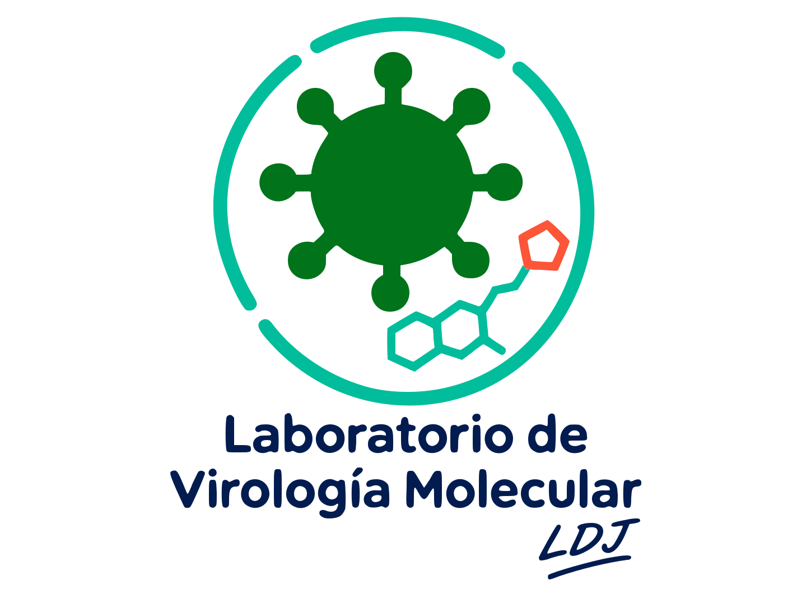

<div align="center">
  

  <h1>LDJ Prism</h1>
  <p><strong>Plataforma interactiva de análisis estadístico, farmacología y visualización científica</strong></p>
  <p>Laboratorio de Virología Molecular · Unidad de Investigación Biomédica de Zacatecas · IMSS · México</p>

  <a href="https://01a1e750-9703-1a6c-416f-888e4c8d8fee.share.connect.posit.cloud/"></a>
  <br>
  
  
  
  <a href="https://github.com/LuisAdrianDeJesus/LDJ-Prism-Demo/actions"></a>
</div>

---

## Acerca del proyecto

**LDJ Prism** es una aplicación desarrollada con R y Shiny para facilitar el análisis reproducible de datos experimentales y la creación de figuras científicas de calidad editorial, sin necesidad de programar. Integra estadística descriptiva e inferencial, regresión concentración–respuesta y evaluación farmacológica en un flujo de trabajo ajustable.

Su desarrollo nace de las necesidades de investigación en virología molecular y descubrimiento de antivirales del Laboratorio de Virología Molecular LDJ.

## Módulos disponibles

| Módulo | Funciones principales |
| --- | --- |
| **Editor universal** | Exploración de datos, gráficas de dispersión, curvas de medias, boxplots y barras. |
| **Citotoxicidad MTT** | Figuras editoriales de hasta ocho paneles, ajustes 3PL/4PL, CC50, IC95%, ANOVA de una vía y Dunnett con controles elegibles. |
| **Actividad farmacológica** | Curvas concentración–respuesta, IC50 e IC95%, actividad antiviral, comparaciones con controles y visualización multipanel. |
| **Potencia y seguridad** | Integración de IC50, CC20 y CC50; conversión de unidades, índice de selectividad (SI) y figuras editoriales de viabilidad y potencia. |

### De los datos a la figura

1. **Datos:** crear una tabla editable, cargar un ejemplo sintético, pegar desde Excel o importar CSV, TSV, XLS o XLSX.
2. **Análisis:** seleccionar el modelo y el umbral, documentar las condiciones experimentales y calcular las estimaciones.
3. **Figura:** personalizar colores, símbolos, líneas, leyendas, ejes, dimensiones y anotaciones.
4. **Exportación:** generar SVG y PDF vectoriales o PNG de alta resolución, con opción de 600 dpi.

El estilo **LDJ Editorial — Original** reproduce la estructura de las figuras científicas desarrolladas en el laboratorio. Los cambios puramente gráficos se mantienen separados de los resultados analíticos.

## Integridad científica

- Trazabilidad de observaciones, controles físicos y unidades experimentales.
- ANOVA y Dunnett únicamente cuando el diseño y la información disponible permiten inferencia.
- Modelos 3PL/4PL con estimaciones e intervalos cuando son calculables.
- Diferenciación entre dispersión observada e incertidumbre del modelo.
- Índice de selectividad calculado como CC50/IC50 tras armonizar las unidades.
- Resultados no determinables (ND) y advertencias explícitas cuando la información es insuficiente.

## Prueba la aplicación

**[Abrir LDJ Prism en Posit Connect Cloud](https://01a1e750-9703-1a6c-416f-888e4c8d8fee.share.connect.posit.cloud/)**

Selecciona un módulo y carga su ejemplo para explorar las herramientas sin preparar un archivo externo.

> **Aviso de privacidad:** esta demostración pública utiliza datos sintéticos. Los datos ingresados se procesan en el servidor; no se garantiza confidencialidad. No introduzcas información clínica, identificable, confidencial ni resultados experimentales inéditos.

## Código y reproducibilidad

La rama [`demo`](https://github.com/LuisAdrianDeJesus/LDJ-Prism-Demo/tree/demo) contiene el código de la versión pública. La aplicación utiliza R 4.6.0, Shiny, ggplot2, patchwork y dependencias fijadas en `manifest.json`.

Consulta [GitHub Actions](https://github.com/LuisAdrianDeJesus/LDJ-Prism-Demo/actions) para revisar las pruebas estadísticas, de regresión, de navegador y de exportación.

Para ejecución local, clona la rama pública y restaura las dependencias del manifiesto en un entorno R compatible:

```bash
git clone --branch demo https://github.com/LuisAdrianDeJesus/LDJ-Prism-Demo.git
cd LDJ-Prism-Demo
```

Una vez instaladas las dependencias declaradas, inicia la aplicación en R:

```r
shiny::runApp(".")
```

## Próximas versiones

| Versión | Alcance | Estado |
| --- | --- | --- |
| **Beta 0.9.2** | Módulos editoriales, editor de ejes y dimensiones, configuración estadística básica/avanzada. | Publicada |
| **Beta 0.9.3** | Selección de controles por identidad física y restauración ampliada de estilos JSON. | En revisión |
| **Synergy Studio** | Análisis de combinaciones, Bliss, HSA, Loewe, ZIP, clasificación de interacciones y comparación con monoterapias. | En desarrollo y validación |

Synergy Studio todavía no forma parte de la versión pública. Los modelos y las inferencias se incorporarán conforme se validen.

## Desarrollo y contacto

**Laboratorio de Virología Molecular LDJ**  
Unidad de Investigación Biomédica de Zacatecas · Instituto Mexicano del Seguro Social

Dirección científica: Dr. Luis Adrián De Jesús González.

Para reportar errores o sugerir mejoras, consulta las [incidencias del repositorio](https://github.com/LuisAdrianDeJesus/LDJ-Prism-Demo/issues).

---

### English overview

**LDJ Prism** is a research-oriented R/Shiny application for reproducible statistical analysis and publication-quality scientific graphics. Its public beta includes a general plotting editor, MTT cytotoxicity, pharmacological activity, and integrated potency and safety analysis. It supports editable data, nonlinear dose–response fitting, eligible ANOVA/Dunnett comparisons, customizable figures and scientific exports. A drug-combination module, Synergy Studio, is under development.

**Use only synthetic or non-confidential data in the public demo.**

<div align="center">
  <strong>LDJ Prism · Ciencia reproducible, desde los datos hasta la figura.</strong>
</div>
